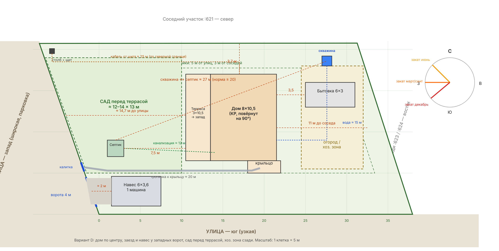

# 🗺️ Зонирование участка — вариант D (рабочий)

> Обсуждение 11.10.2026. Пока концепция: перед свайным полем проверить отступы по ПЗЗ и вынести оси дома в натуру по этой схеме.

Векторная версия: [site-plan-v4.svg](site-plan-v4.svg) · генератор: [site-plan.py](site-plan.py) (`python site-plan.py` → SVG).

## Участок

Геометрия по ЕГРН (МСК-68), параллелограмм ≈ 38 × 20,7 м, 794 м².

| Точка | X | Y | Локально (x восток, y север), м |
|---|---|---|---|
| 1 (СЗ) | 438910.10 | 1240909.38 | (−7,23; 20,73) |
| 2 (СВ) | 438914.97 | 1240947.57 | (31,27; 20,77) |
| 3 (ЮВ) | 438895.20 | 1240956.83 | (37,98; 0) |
| 4 (ЮЗ) | 438890.44 | 1240919.15 | (0; 0) |

Окружение: **запад** — широкая улица (парковка на обочине), **юг** — узкая улица, **север** — участок :621, **восток** — :623 / :624. Столб и щит учёта — северо-западный угол (уточнить на месте).

## Решения

| Объект | Где | Почему |
|---|---|---|
| Дом 8×10,5 + терраса 3×10,5 | По центру, x 10,5–21,5 м; повёрнут на 90°, терраса на **запад** | Закаты (июнь ~315°, март/сент 270°, декабрь ~230°); сад перед террасой, хоз. зона сзади |
| Крыльцо 1,5×4 | Южная сторона, у ЮВ угла дома | Короткая тропинка от калитки |
| Въезд + калитка | Западная улица, ЮЗ угол, ворота 4 м | Широкая улица, парковка |
| Навес на 1 машину 6×3,6 | Сразу за воротами | Проезд по участку не нужен — не съедает площадь |
| Тропинка | Вдоль южной границы, ≈ 20 м | |
| Сад | Западная половина, ≈ 12–14 × 13 м | Вид с террасы |
| Бытовка 6×3 | За домом (восток), 3,5 м от дома | |
| Огород / хоз. зона | Восток, ≈ 7,5 × 13 м | |
| Скважина | СВ угол | Вода до дома ≈ 15 м |
| Септик 2×2 | Запад, у калитки | Канализация ≈ 12 м, до скважины ≈ 27 м (норма ≥ 20), подъезд ассенизатора с улицы |
| Кабель ввода | По северной границе | ≈ 25 м от щита |
| Баня | — | Не нужна |

## Отступы

До северного соседа 3,7 м, до восточного ≈ 11 м, до южной улицы 5 м, терраса до западной улицы ≈ 14,7 м. Граница застройки на схеме — 5 м от улиц, 3 м от соседей.

## Проверить

- [ ] ПЗЗ Тамбовского района: допустимый отступ **навеса** от улицы (на схеме ≈ 2 м). Если нужно 5 м — сдвинуть навес восточнее.
- [ ] Угол столба со щитом (принят СЗ).
- [ ] Разгрузка материалов и свай — с улицы (проезда по участку нет); бурить скважину до забора, пока проезжает буровая.
- [ ] Вынести оси дома в натуру перед сваями.

История вариантов: A — терраса на юг; B — терраса на запад; C — въезд с запада, проезд вдоль юга; **D — дом по центру, без проезда (выбран)**.
